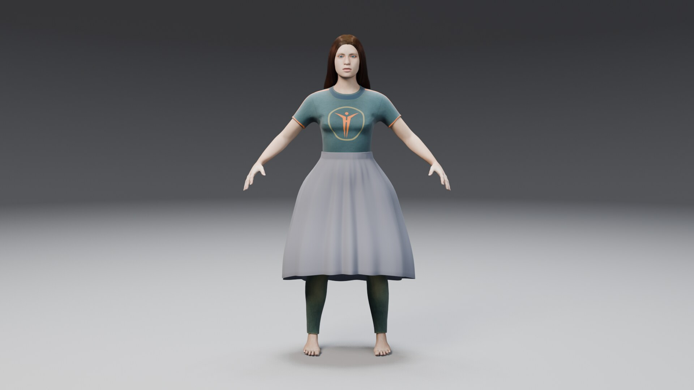

# FIRST PERFORMANCE · generic Ex1 stills

I opened both original 1920 × 1080 PNGs from the final EEVEE Next render. Blender 4.5.17 LTS and MPFB 2.0.18 rendered frame 0 of the same restrained libgibson idle tape at 48 samples per pixel. Code revision `79a0b0eb7e2305396cc2d67151e714ccf8f1a2b0`.



## What I saw

- **Front.** A narrow waistband follows the teal shirt at both hips. Vertical folds open below it and end in a shallow, wavy hem. I see an unbroken skirt surface over each hip and a continuous shadow touching both bare feet. A dark strip of lining makes the hem look heavy. The skirt flares almost symmetrically, and both arms angle out with the wrists hanging sharply down. The silhouette still reads as a rig reference pose.
- **Face.** Both blue irises are visible through the lashes and catch the studio lights. Individual brow hairs and the skin texture on the cheeks are visible. The wide eyes and slightly parted lips give the face a fixed expression. Two thin curved seams cross the brown crown, and a short vertical edge at the centre part reveals where two hair cards meet.
- **Compared with earlier renders.** The first fringe crossed itself above the forehead. The native long01 part cleared the eyes, but a broad silver patch appeared across its crown. Four crops varied the rim reflection and the underlying scalp colour independently. The silver patch followed the rim reflection in all four. Keeping the rim's diffuse light and shadow restored the brown crown in the final still. The crops are in the local `crown-light/` directory.

## Measurements and controls

| Measurement at tape frame 0 | Observed result |
| --- | --- |
| Projected height of dressed figure | Front 82.45%, side 84.28%, three-quarter 83.63%, back 83.26%. All four use the same target, radius, 60 mm lens and 5° elevation. |
| Face framing | The sampled head region spans 74.00% of the 85 mm close-up. The rendered views are front and face. The side, three-quarter and back values come from camera projections. |
| Ground contact | The ground and lowest foot-associated surface point are both at z = 0.000793920 m. Gap 0 m. |
| Under-foot shadow | On the 960 × 540 check image, 17.78% of the 3,448 unmasked near-foot pixels fall below 80% of the surrounding ground median. The existing minimum is 15%. Lowering the receiver 0.40 m gave 0% and failed both contact and shadow checks. |
| Wardrobe layering | Both garments have runtime Fitted verdicts. The compiler moved 128 of 2,197 suit vertices, up to 9.73 mm. The fitted 3,456-vertex skirt has zero penetrating vertices. The final posed, subdivided 3 mm skirt and suit have zero intersecting polygon pairs. |
| Eye clearance | The evaluated long01 surface blocked 0 of 598 iris rays from each camera. An opaque obstruction blocked all 598 from each. The coarse eye-box count includes 75 cage vertices, so it cannot establish iris occlusion on its own. |
| Checks | All 16 final render checks passed. The displaced-receiver run exited 5 as expected. The earlier first pass failed the shadow check at 13.50%. An earlier compile lease exited 2 after the shell runner was edited mid-run. The complete export, tape, render and control sequence subsequently passed. |

The licence audit accepted 58 rows and all 52 source entries used by the export. The GLB contains embedded base-colour textures on the body, long01, suit, eyes, brows and lashes. The generic Blender skin uses Principled subsurface weight 0.22 and scale 0.003 m. Both stills use the compiler's fit positions and tape identity. The collision and sightline results above cover this still pose.

## Local originals and regeneration

Paths below are relative to `/home/leah/.local/state/first-performance/codex-fp/`. The committed JPEG is a 66,045-byte derivative of the full front. The render report, first-pass images and diagnostic logs remain beside the originals.

| File | SHA-256 |
| --- | --- |
| `render/stills/ex1_character_front_1920x1080.png` | `c987e6de90c491db930497842586039691714dac1506b7ff04f62537366c25cb` |
| `render/stills/ex1_character_face_closeup_1920x1080.png` | `ec395c84f2223128cbde85b3711b9059729875bf2697648fa8995441b311ff0a` |
| `render/render.json` | `62da52657d02a1383172ace5ac7c07c2b0e92af0d3c70262fc118868b20b6fb4` |
| `export/body_shaped.glb` | `f7c8e2975c2ad8682725ae5377a43ce0138079f1395afb8d831da4746364ac0f` |
| `export/manifest.json` | `c96b2ec952aedcec907413a324520792d33f0668ddbd4146119ec93b0189a2cb` |
| `asset/body.gfa` | `e1f467e2cd69d8b8654bb0af4af0e1a5c4b02d8a49c7a945b9a709eb9fa1edd4` |
| `tape/generic.tape.json` | `8d0fbe84bc23c1ecea221b9c8b95928d05cd350a42ceaaabfad56b877e763722` |
| `tape/generic.tape.bin` | `60b86858f659c6287632cc9f555465df81a31247c2aee3a9b5a7643488b92da8` |
| `tape/generic.fit.json` | `916e2a92bb9f1fe05749883e9fc3b666a349d75adf0f63e09a3cd248f4b56153` |

From the libgibson worktree with the installed MPFB system pack and the offline Rust dependencies, regenerate both originals and their controls under one lease.

```bash
/media/leah/SPANKBANK/GOD/bin/heavy run --who Codex/fp-adapter \
  --why 'FP adapter fidelity still (GOD #118)' --class s --max-min 15 -- bash -ec '
    runner=tools/figure_assets/lease_fp_stills.sh
    bash "$runner" export
    bash "$runner" tape
    bash "$runner" render
    bash "$runner" controls
  '
```
