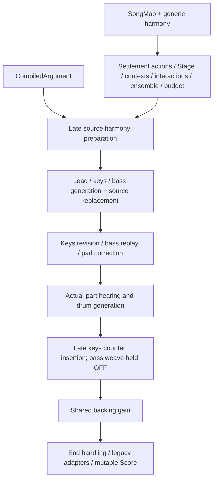
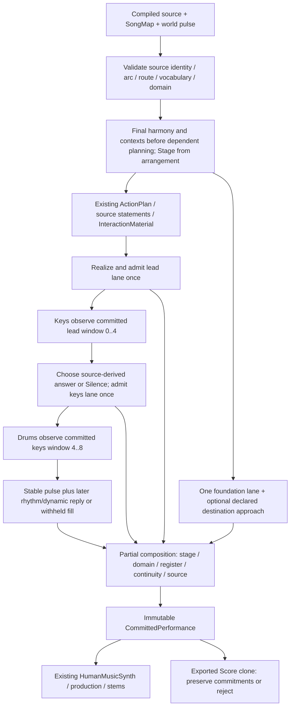

# C137 causal kernel: integration and listening handoff

This checkpoint implements an opt-in **16-beat conversation** over the existing
HumanMusic production types. It does not replace the full fusion arranger or
establish musical acceptance. Keep `BASS_WEAVE` disabled and retain the archived
performers as compatibility controls. Do not merge, release, tag, or change
historical defaults on the strength of this checkpoint.

Runtime and audition source is frozen at
`ac97bccba88beb768720c67ac64200f6778d0584` on
`feat/humanmusic-c137-causal-kernel`, in `/home/leah/LibGibson.kernel`.
Later commits contain evidence and documentation only. The original workspace
and historical defaults remain untouched. Exact delivery-head CI is recorded
in the draft PR description; it is separate from local runtime receipts.

## Verified diagnosis and limits

Baseline runtime: PR #102, `29527a891ed7bfed9657a99046884a61670897e3`.
Research source: PR #103, `12eb9f2b72c80ff116bcf584aacfe0751bde286a`.
The recorded baseline exact-head CI run is `38197706708`; it is not CI evidence
for this new branch. The refreshed PR #95–#103 stack is in
[upstream_prs.json](upstream_prs.json).

| Finding | Evidence and status | Claim limit |
|---|---|---|
| Legacy hearing omits dynamics | Actual Rust velocity-only mutation leaves `Hearing` equal and `stale_hearings()` empty while the Score fingerprint changes; a subsequent pitch mutation is detected. Desired broad dynamic invariant was run red. | Legacy tuple limitation, not proof of a failed velocity-dependent legacy drummer choice: that drummer consumes onset counts. |
| Counterpoint changes already-consumed events | At the archived 108 BPM fusion fixture, OFF has 0 stale hearings and ON has 3, all consuming keys. Fifteen ON bars' final onset counts disagree with the drummer receipt; drums remain identical across arms. Actual 144 BPM ON audio control also has 3 stale hearings. | A demonstrated event/order failure. It does not imply every count mismatch changes the arbitration outcome or quantify perceptual damage. |
| Source harmony is installed after a pitch-sensitive decision | The baseline settlement planner chooses home-root Resolve targets at beats 120 or 104; late source installation changes those chords from A to F while retaining the action. | Demonstrated intermediate-plan failure. Later rehearsal can remove/recast it; this is not proof that every final legacy Score retains that action. |
| Some suspected stale dependencies were overstated | Same-boundary root mutation leaves accents, interactions, ensemble and budget unchanged; those consumers do not all read chord pitches. Budget does not read drive and is a weighted texture cap. | No claim that every unchanged field is erroneous, or that the cap measures musical information. |
| Source identity was not enforced at the public preparation seam | Baseline preparation accepts a foreign plan owner and silently fills missing route entries with tonic minor. Actual foreign-owner refusal oracle was run red. | Hostile inputs to a public seam; normal compilation was not shown to create them. |
| Continuity validation is weaker than bass capacity | Real Rust/PCM probes admit a disconnected overlapping bass voice, simultaneous bass pitches, and rapid same-pitch retriggers under valid/empty edge sets. | Refutes edge-validity-as-mono-proof. Low register alone is not the defect, and PCM difference is not a masking or listening verdict. |
| Count-based keys Listen cannot identify these calls | Equal-count/equal-energy opposite contours give identical controlled comp output. Existing `InteractionMaterial` transforms give different source-linked replies. | Isolates the comp projection; the whole interaction system is not pitch-blind. No new cue ontology is needed for the slice. |
| Initial kernel admission protected inputs but not all commitments | Independent mutation pass at `f042bb0` ran 16 tests: 14 failed, 2 passed. Unheard bass/drum consequences and redundant source metadata could change without refusal. | A real defect in the first kernel checkpoint, not a claim that its unmutated take contained those mutants. Preserve [hostile_red.txt](hostile_red.txt); final correction needs the green receipt below. |

Details and raw commands: [hearing_baseline.md](hearing_baseline.md),
[authority_baseline.md](authority_baseline.md), [bass_teacher.md](bass_teacher.md),
[hostile.md](hostile.md), and [acoustic_baseline.md](acoustic_baseline.md).
These are separate probes sharing repository/model lineage, not independent
listeners or an external acoustic certification.

## Authority before and after

The archived route has two harmonic writers and permits mutation after hearing:



The opt-in kernel admits one common base and commits each role before a dependent
consumes its bounded window:



| Responsibility | Owner in the bounded path |
|---|---|
| Final harmony and source identity | Source argument/route admitted through private `AdmissionInputs.argument` before `PerformancePlan`'s first harmonic-dependent decision; competing cover authority and discretionary harmonic rewrites are refused. |
| Semantic obligations | Source referents, transforms, carriers and arc reservations; existing raw argument witness checks realized source. Generic action generation is disabled for this slice. It is not a general discharge of every full-song discourse obligation. |
| Shared pulse and local phase | World tempo, four-beat meter, quarter-beat source lattice; fixed keys relation `+0.0625` beats; steady drum anchors; licensed bass pickup at 11.5 and return at 12. |
| Role responsibility and permission | Existing arrangement/Stage plus source carriers and existing Call/Response/ActionPlan records. The kernel's small deterministic role policies choose the actual contributions. |
| Onsets, gates, intensity and continuity | Each lane's realizer chooses its final values before commit. Bass and lead supply explicit continuation identities. No later performer may revise an earlier lane. |
| Actual hearing | `EffectiveHearing` records only the consumed onset window, including event identity, gate, velocity, pitch function and relevant explicit links. Future source declarations are excluded from these actual-hearing windows. |
| Post-commit change | `CommittedPerformance` exposes shared references. `validate_candidate` rejects changed committed events/continuity/base as well as changed consumed inputs; a new source must re-enter `perform`. |

The load-bearing categorical content is the implemented partial composition:
role streams share an admitted source/pulse base, retain distinct events, and
compose only inside stage, time, source and voice domains. `commit_role` consumes
a lane once, refuses a second lane or foreign continuity endpoints, and validates
before observation. Failure returns no partial take. The strengthened exported
candidate boundary also preserves the output of each commitment, not merely the
input of its hearing arrow. Different newly performed sources can make different
valid takes; this identity law does not demand one universal performance.

No general associativity theorem or complete category of arbitrary performances
is claimed. There is no global consonance optimizer or new repair manager.

## What the conversation does

`examples/c137_conversation/source.rs` obtains an original seeded cell from the
existing `ThemeFamily` generator, specifies its breath and completion at the
source, and compiles a `MusicalArgument`. It does not copy handwritten teacher
notes. The currently admitted domain is deliberately narrow:

- Exactly four 4/4 bars, two lead-only source placements with reservations
  `[0,12)` and `[12,16)`, and four route entries.
- Source events use semitone pitch basis, quarter-beat onsets and a first-bar
  statement fitting before beat 3.75. Arc, steps, phrase IDs, placements and
  transformed referent events and canonical thematic sites must agree. Source
  accents and section gains must be positive; gains must be finite and at most one.
  The first relation is Establish, the second its Return, and the ending Resolved.
- The final route includes dominant at beat 8 and tonic minor at beat 12; the
  returning statement completes on the tonic. Arbitrary meters, forms, carrier
  transfers and harmonic routes are outside this public entry point's domain.

The lead states its cell, then breathes. Keys hear the completed first bar: a
tonic close invites silence, an open rising line invites inversion, and a falling
line invites quotation. Existing `transform_material` and harmonic projection
realize the reply; this is a declared projected response, not exact chromatic
copying. Its intensity derives from the actual committed call. Keys deliberately
withhold the third-bar repeat even where Stage permits playing, leaving room for
the return. This is a small explicit local-history policy, not generalized memory.

Bass keeps one chronological foundation lane, with each bar's root and a
chord-relative third or final chord tone (fifth in the demonstrated minor triads,
seventh when that chord supplies one). A feasible semitone approach anticipates the
declared root at beat 12. It is not snapped to the current chord or overlaid as a
second low-register melody. The bounded bass register is MIDI 36–55. Admission
checks written overlap, rapid same-pitch retrigger, explicit identity and the
existing direct-voice audible-end model with the renderer's choke allowance.
That model excludes shared reverb and is an acoustic approximation, not a new
perceptual masking proof. Bass stage exclusion refuses this foundation-required
conversation; general transfers or purposeful bass withholding remain future work.

Drum anchors keep the common pulse. A later fill echoes the final keys attacks
and their actual velocities; a withheld keys window removes that fill. Keys,
bass, lead and drums do not share a final energy multiplier. The pad is deliberately
empty. These are causal/source relations visible in events; whether the result
sounds like recognizable independent musicians remains a listening question.

## Simplification and compatibility

The new path **bypasses** late `prepare_performance`, generic comp's count-only
Listen decision, generic generated-lead replacement, late counter insertion,
keys-identity retry/bass replay, pad joint correction, shared backing gain, and
post-hearing bass deletion/tie/clip/relink chains. Required source transport is
reused on an empty lane, so it does not first generate disposable notes.

The existing budget is recomputed as a readout after decisions; it cannot edit
those events or certify semantic density. Existing plan storage still includes
ensemble/budget fields for compatibility. No claim is made that every unused
plan field has been removed or that the complete planner is now minimal.

Legacy `perform*` entry points, `HeardNote` tuple, Score layout/fingerprint
semantics, production defaults and old repair adapters remain. The old argument
route does not automatically opt into this new private admission input.
`CoupledR8` remains the ear-rejected negative control. Simplification here is the
removal of conflicting writers **from this execution path**, not deletion of
historical code or a source-line target.

The strengthened source-owner comparison uses complete in-process Debug content
because the historical song fingerprint omits fields. It is an admission guard,
not a portable canonical serialization; replacing it would require a separate
explicit owner-equivalence contract while preserving old fingerprints.

## Code, falsifiers and final receipts

Runtime: `src/audio/human_music/kernel.rs`, `performance.rs`, and module export.
`argument.rs` shares its existing canonical thematic projection with admission.
Five pre-existing match/Boolean expressions received equivalent clippy cleanup;
archived audio and full regression gates verify compatibility.
Demonstration: `examples/c137_conversation.rs` plus its `source.rs`.
New checks: `tests/audio_c137_conversation.rs`, `audio_c137_kernel_hostile.rs`,
`audio_c137_kernel_baseline.rs`, `audio_c137_source_authority.rs`,
`audio_c137_bass_capacity.rs`, and private planner tests in `kernel.rs`.

The conversation checks distinguish equal-count/equal-energy calls; mutate
consumed velocity and source identity; subtract the keys cue while preserving
unrelated lead, bass and pulse anchors; refuse source silence and capacity
intrusions; verify phase/recovery; and exercise fresh seeds/transposed tonics.
The hostile suite preserves the initially successful counterexamples against
commitment/source admission. Legacy desired-invariant tests intentionally remain
ignored red oracles; ordinary characterization tests actively preserve their
known negative-control behavior. Do not silently run those red oracles as a
requirement that historical public behavior changed.

| Required receipt | Result |
|---|---|
| Runtime SHA / branch | `ac97bccba88beb768720c67ac64200f6778d0584` / `feat/humanmusic-c137-causal-kernel` |
| Focused tests | 9 conversation + 19 hostile + 2 planner tests pass; [raw output](hostile_green.txt). Legacy characterization also passes; original red oracles remain preserved. |
| Full Cargo and examples | 1,681 passed, 22 intentionally ignored; 19 additional example-specific tests passed. All examples built. |
| Format / strict clippy / rustdoc / release | Passed locally; rustdoc used `RUSTDOCFLAGS=-D warnings`, clippy all targets/features with `-D warnings`. Commands and logs are in [validation](validation/). |
| Historic R17/covers/fingerprint/PCM | 48 archived WAV hashes and 757 diagnostic receipts reproduced byte-exactly; zero mismatches. Cover/fingerprint/PCM integration checks passed in the full suite. |
| Exact-head CI | See the draft PR's exact-head run link and conclusion. Local checks are not substituted for CI. |
| Actual WAVs and copied custody | 81 WAVs at `/media/leah/SPANKBANK/LibGibson-c137/ac97bcc/audition`; [copy custody](copy_custody.json), [all file SHA-256](candidate_sha256.txt). Original output remains at `target/c137-audition-ac97bcc`. |
| Independent analysis | [PCM/Score report](acoustic_candidate.md), [measurements](candidate_measurements.json), [comparisons](candidate_summary.json). Nine committed variants passed finite floating PCM and exact block-127/256 equality. |
| Maintainer listening against teacher_golden7 | **PENDING.** Complete accepted collection unavailable; no acceptance granted. |

| Seed | Source Debug FNV | Song fingerprint | Performance fingerprint | Score fingerprint |
|---|---|---|---|---|
| 2112 | `bf1be50c542248e9` | `c98735ed499f9f20` | `37753f2f7879396a` | `468ddeeb851c6101` |
| 7 | `dc68c5455f46a91a` | `c98735ed499f9f20` | `5a86f0ea1c6d138b` | `468ddeeb851c6101` |
| 99 | `e8afbc370ae1b4b3` | `550a2b211f26488c` | `6e0d1f2ee13bdde7` | `32509f436ee58573` |

These fingerprints describe different projections. Seeds 2112/7 render identical
PCM despite different source/provenance hashes; all three candidates have
identical non-lead stems. The full mix bar RMS span is only 0.2835 dB. Do not
infer broad musical diversity or expressive success from seed count or receipts.
The source Debug FNV is not a canonical semantic or cryptographic identity.

The example supports the following reproduction; replace placeholders and use
an empty output directory. The archived render used the exact runtime SHA above:

```bash
CARGO_BUILD_JOBS=1 cargo test --test audio_c137_conversation --test audio_c137_kernel_hostile
CARGO_BUILD_JOBS=1 cargo run --release --example c137_conversation -- \
  --out=EMPTY_OUTPUT_DIRECTORY --seeds=2112,7,99 --tempo=144 \
  --source-sha=ac97bccba88beb768720c67ac64200f6778d0584
```

The example records source/Score/plan/hearing dumps and fingerprints; renders
normal, nocomp and harmonic-reference output from the same Score; renders five
solo buses; checks finite floating-point PCM and exact block-size independence;
and emits replanned source controls plus explicitly uncommitted exported mute
controls. Its FNV checksums are not cryptographic. Run `measure_audio.py` on the
WAVs and `score.tsv` files for independent PCM/score observations and SHA-256.
Solo outputs pass through shared production and need not add to the full mix.
Exported mute controls must remain labeled rejected/uncommitted even when useful
for listening subtraction; their dependents were deliberately not replanned.

Already captured baseline controls live at
`/home/leah/LibGibson.kernel-bass/target/c137-controls`; matched reconstructed
teacher controls/stems live at `target/reconstructed-teacher` in that worktree.
The baseline normal ON Score fingerprint is `001e6801b304a08a`, WAV SHA-256
`03bbe35ea057f538fdf4a9ba86e88a36b739a22164a5366fc6130a8c910740f2`.
Hash-verified copies now also live under the `/media` artifact root in
`pr102-controls` and `reproduced-teacher`. These local media are not
repository-committed distribution artifacts.

## Claude integration boundary and next work

Start from the final implementation SHA and filled receipts, read the retained
red evidence, then use `kernel::perform` explicitly for this bounded source.
Do not route historical defaults through it or re-enable bass weaving.

R0 is evidenced by actual baseline probes. The implementation targets a complete
R1 conversation and bounded R2 source/commit discipline, with selective R4
bypasses. **R3 full-song ThemeFamily verse/hook/bridge/return generalization and
the complete R5 program are deferred.** Wider dialogue, varying form/meter,
broader source expression, local memory over multiple conversations, and a
feasible bass answer need their own domains and falsifiers after listening.
Avoid promoting this deterministic four-bar policy to general musician agency.
The bass-approach mute has no dependent decision in this slice; its value remains
a listening question. Existing Quote/Invert transforms already cap the keyboard
reply at four events, below the six-voice pool, so no new capacity policy was
added for that unreachable overflow hypothesis.

One narrative teacher was recovered and freshly reproduced byte-exactly. The
full accepted `teacher_golden7` collection and its complete custody/acceptance
record remain unavailable. Keep reconstructed references labeled as such.
Source conformance, immutable commitments, causal subtraction and real PCM are
necessary evidence; none substitutes for the maintainer hearing the candidate,
controls and teacher and deciding whether the music earned continuation.
