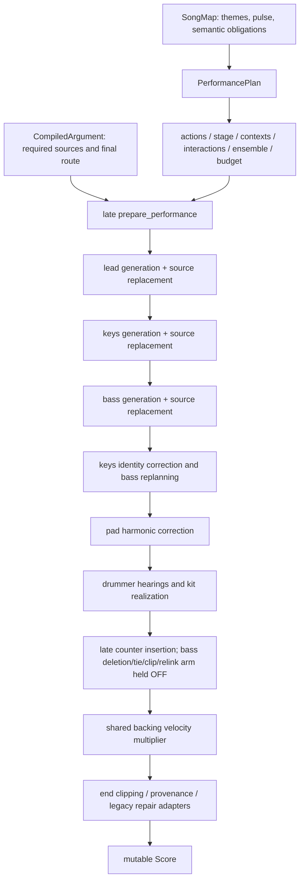

# C137 causal kernel checkpoint

Implementation base: `29527a891ed7bfed9657a99046884a61670897e3` (PR #102).
Research source: PR #103, `12eb9f2b72c80ff116bcf584aacfe0751bde286a`.
The live GitHub check confirmed run `38197706708` succeeded on the exact base.
`upstream_prs.json` records the independently refreshed PR #95–#103 dependency stack.

## R0 predictions, before Rust execution

* A velocity-only mutation leaves legacy `HeardNote` equal and `stale_hearings()`
  empty. Inserting a note must be distinguishable by that observer.
* Fusion counterpoint OFF is expected to have no event-stale drummer hearing;
  ON is expected to make the drummer's keys hearing stale. Both can remain blind
  to velocity. A contrary result must be retained, not explained away.
* Installing source harmony late is a split authority. A changed root does not
  necessarily invalidate a decision that only reads chord boundaries. Find a
  concrete affected consumer before claiming a runtime planning failure.
* A mono flag alone is not a physical lane-capacity proof. Disconnected overlapping
  notes can survive the existing continuity-edge validator.

## Before: ownership and mutation DAG

| Property | Authority / later writers | Existing observation boundary |
|---|---|---|
| Final harmony | generic harmony/actions, then argument route | downstream plans already exist |
| Semantic obligation | argument referents/relations; generic discourse ledger separately | raw argument witness checks source content |
| Pulse | accent grid/language; source transport uses authored timing | source and pocket witnesses |
| Responsibility | arrangement → Stage; argument carrier reservations | stage admission and argument witness |
| Onsets/gates | role generators, source replacement, optional late weave, end clip | legacy hearing sees event tuple |
| Intensity | role generator, source accent × section gain, late shared backing gain | legacy hearing omits velocity |
| Continuity | pocket links; late bass weave rebuild | endpoint validation does not prove capacity |
| Revision | identity retry, optional weave, legacy repair arms | invalidation is local, not comprehensive |

## Bounded implementation decision

Prioritize one complete four-bar conversation and an opt-in frozen performance
over an unfinished whole-song rewrite. Reuse SongMap, MusicalArgument,
PerformancePlan, Stage, ActionPlan, Interaction, MaterialSource and Score.
Final source harmony enters the existing planner before dependent decisions.
Role streams compose only when source, stage, time domain, register and mono
capacity are compatible. A dependent consumes a committed time window; its
effective observation includes the dynamics and source identity it actually uses.
No final shared gain, weave insertion, voice surgery or harmonic repair follows
that consumption on this path. Historical entry points remain controls.

The scouts share a repository lineage and model family. Their methods and scopes
are separate; their conclusions are not three independent acoustic auditions.
The Python seam probe is preserved unchanged and ran against the full base
checkout: five synthetic tests and ten source checks passed. It is not Rust proof.

Human listening against accepted teacher_golden7 remains PENDING. R3 whole-song
generalization is contingent on this bounded construction and its listening gate.

## Delivered bounded checkpoint

Runtime and rendered audio: `ac97bccba88beb768720c67ac64200f6778d0584`.
Read [HANDOFF.md](HANDOFF.md) for the final ownership DAG, partial composition
boundary, concrete code/tests, commands, fingerprints and remaining work.
[acoustic_candidate.md](acoustic_candidate.md) reports independent measurements
of actual candidate/control WAVs; [validation](validation/) retains local commands
and raw outputs. Exact delivery-head CI is recorded in the draft PR description.

Local validation passed: 1,681 Cargo tests (22 intentionally ignored), 19 example
checks, all examples, fmt, strict clippy, warnings-denied rustdoc and release build.
R17 regenerated all 48 required WAVs and 757 diagnostic receipts byte-exactly.
The old accepted/failed archives were not edited or replaced; no fresh holdout
was used. This is not a new claim of general R17 success.

The audition and reference packet is copied, with every copied file hash checked,
to `/media/leah/SPANKBANK/LibGibson-c137/ac97bcc/`. The replay is also stored there.
Start with `audition/seed-2112/candidate/full.normal.wav`, then compare
`keys-withheld-replanned`, `closed-call-replanned`, the three exported mutes,
normal/nocomp/harmonic-reference controls and the solo buses. Seed99 supplies
one changed lead; seed7 duplicates the seed2112 candidate. All non-lead candidate
stems remain identical across these seeds. Human acceptance against the complete
accepted teacher_golden7 collection remains pending; only one reproduced
narrative teacher is available.
