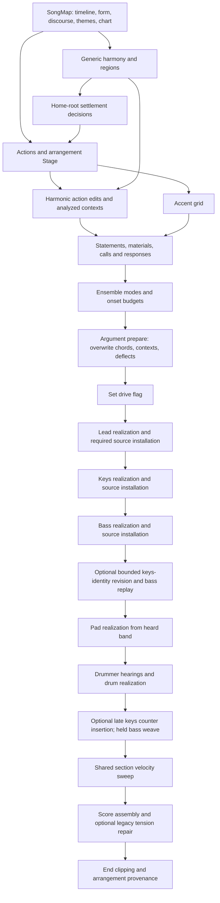

# C137 authority baseline and minimal kernel seam

This is a source-authority workstream, not a listening verdict or a runtime repair.
Baseline: `29527a891ed7bfed9657a99046884a61670897e3` (PR #102).
Research read in full: PR #103 head `12eb9f2b72c80ff116bcf584aacfe0751bde286a`,
`docs/research/HUMANMUSIC_C137_PERFORMANCE_KERNEL_ROAST.md`.
The scout worked in `research/c137-kernel-authority`, isolated from the integrator.

## The first demonstrated stale harmonic decision

`PerformancePlan::build` calls `plan_settlements` before argument harmony is installed.
For harmonic departures and suspended cadences that function explicitly selects the
first chord with the **home root** inside the settling phrase. This is a genuine
pitch-sensitive decision, unlike the accent and onset-budget planners.

Executable fixture: `deflected_lift_trace(128)`, composition seed `2112`,
`MusicalArgument::calibration(..., 91)`, BLACK_ICE, default performance options,
`PerformanceProfile::BAND`. Build the generic performance with `perform_candidate`,
then invoke the same public `prepare_performance` mutator the argument path uses.

| Source family | Planned Resolve target | Chord before source install | Chord afterward | Action after install |
|---|---:|---|---|---|
| CallAndEarnedAnswer | 120 | A Min6, home root 9 | F Maj, root 5 | Same action, target, cause |
| PromiseDeniedReturn | 104 | A Min6, home root 9 | F Maj, root 5 | Same action, target, cause |

The target was selected because it was home, and source installation invalidates that
premise. This is an **observed intermediate-plan failure**. It is not a claim that
`perform_argument` necessarily emits the stale action: its later rehearsal can remove
or recast verbs. It is also not a claim that each short calibration phrase contains a
later valid home arrival. Neither claim is needed to show the contradictory writers.
A discourse debt can bind a different cadence Hit, so the probe does not equate this
Resolve action's ID with the final obligation ledger's chosen witness.

The correction belongs before `plan_settlements`. Rebuilding the whole band after
installing the chord is a more expensive way to discover a source choice already known.

## Counterevidence that narrows the research diagnosis

At this baseline:

- `ActionPlan::build_with` takes timeline/backbone/language/form/seed, not chord pitches.
- `build_accent_grid` consumes actions and phrase targets, not chord pitches.
- `plan_interactions` reads chord **boundaries** only, through `crosses`; same-boundary
  root/quality changes do not alter that flag.
- `plan_ensemble` reads the actions, statements, interactions, language and Stage.
- `budget::allocate` reads reservations, ensemble texture targets and Stage. It never
  reads `drive`. Calling it a semantic-density or chord-correctness test is false.

The Rust root-mutation control changes the first source chord to V7, verifies the
changed context, and verifies unchanged actions, statements, accents, interactions,
ensemble decisions and budget. These unchanged fields are not by themselves failures.
The argument path's late `drive=true` enables denser realizers, but its timing does not
by itself prove a stale allocation: the allocator has no drive input.

## Two additional authority-boundary falsifiers

`prepare_performance` validates the argument program, vocabulary and tonal compatibility,
but accepts a performance whose `song_fingerprint` belongs to a different argument song.
It leaves the foreign statements and owner fingerprint in place while replacing harmony.
That public seam is not an ownership-preserving construction.

It also accepts an empty `CompiledArgument.route`: the missing entries silently become
`(0, Quality::Min)`. The field's contract says one entry per form bar. A frozen source
boundary must validate exact coverage and reject missing/extra entries, not invent a
replacement harmony under the old source identity.

Both are hostile mutations of actual production structures. They are not assertions
that normal compilation currently produces either malformed state.

## Current dependency and mutation DAG



| Property | Authoritative source and consumers | Later writer or observational limit |
|---|---|---|
| Final harmony | Song chart, generic realization, harmonic actions; settlement planner selects home chords | Argument preparation overwrites harmony after dependent construction |
| Semantic obligations | Song discourse ledger; ActionPlan settlement and source argument placements | Rehearsal rejects/recasts actions; raw argument witness is separate from discourse receipts |
| Shared pulse | World subdivision/swing, rhythm lattice; AccentGrid selects musical accents | `land_once`, expressive source planning and selected offsets must retain their declared relationship |
| Responsibilities | Arrangement Stage plus admitted ActionPlan windows and source reservations | Counter insertion asks seat presence but is not a planned transfer of responsibilities |
| Onsets and gates | Role realizers, source transport, source-expression policy | Counter insertion/removal, held bass tying/clipping, end clipping, optional historical repairs |
| Intensity | Source event accent/section gain; realizer dynamics and Stage level | Argument backing sweep modifies every non-carrier role after hearing |
| Continuity | Explicit source event edges; mono renderer reads those identities | Counter weave reconstructs links after earlier consumers |
| Actual observation | `Hearing::of` snapshots notes; pad and kit read actual arrays | Legacy projection omits velocity and continuity; whole-part snapshot is not a timed causal hearing |
| Source replies | InteractionMaterial + MaterialSource::Derived | Generic `Listen` only changes stab allowance from lead onset count |
| Silence | Stage exclusion, source reservation, or an explicitly empty response window | `Transform::Silence` alone produces no answer material but does not prohibit generic comp filling the window |

These paths have different compatibility purposes. The goal is to remove contradictory
writers on the new path, not delete all verification or weaken historical behavior.

## Smallest seam and reuse recommendation

A crate-private source input to `PerformancePlan::build`, selected before its first
harmonic/action decision, is enough to establish one route authority. Validate source
owner, extent, route coverage and vocabulary there. Source-pinned harmony must refuse
later discretionary harmonic rewrite actions (the cover path already demonstrates this
admission pattern). Build the dependent plan only after final harmony exists.

For the bounded conversation, existing objects suffice:

- `ActionPlan::push`, `ActionCause::Interaction`, `Answer.pays` and typed IDs.
- `Call`, `Response`, `Interaction`, `InteractionMaterial`, `MaterialSource::Derived`.
- `transform_material`; its output actually depends on source intervals, rhythm and
  accents, unlike the onset-count proxy.
- `Transform::Silence` as a decision, plus ownership of the whole response window so
  another comp generator cannot fill the deliberate silence.
- `Stage::on_stage_span`, `PerformanceDomain`, final `contexts`, source register and
  mono occupancy checks as partial-domain conditions.
- `HeardWindows::explicit` and explicit `VoiceContinuation` for the effective direct
  lifetime law. `VoiceContinuation::new` alone does not establish same-gesture identity.

An immutable final take wrapper can prevent the new path from mutating committed events
through its API. Its observation edges must read the final effective values actually
consumed by the next player, in a bounded window that ends no later than the response
starts. A declared future source cue is a different operation from hearing an actual
future note. The wrapper need not redefine historical `Score` or `HeardNote` semantics.

The useful categorical content is operational: the source context is the common base;
each committed role stream remains its own local object over that base; composition is
only defined when source identity, interval ownership, stage permission and voice
capacity agree. Different intensity and phase trajectories remain admissible. No global
consonance optimizer, new independent Cue taxonomy, or joint energy scalar follows from
this construction.

`InteractionMemory` is currently a private signature history (responder, latency,
position, transform). It does not store source content. For one conversation the current
material identity and final direction are enough local memory; adding a memory manager
would not help demonstrate the causal claim.

## Positive transport control and remaining limitation

The executable material test uses `[0,4,7]` and `[0,7,4]` with identical onsets, gates,
accents and event count. Existing `Transform::Invert` yields distinct answer events with
`MaterialSource::Derived` identity. Changing unrelated statement/motif labels leaves the
answer events unchanged. `Silence` yields no material. This establishes that the existing
transport machinery retains the needed distinction, not that current keys Listen uses it.

`comp::answer_notes` adds harmonic projection, `land_once` accent placement, and a Stage
level floor of 0.85. It cannot be presumed an exact chromatic/rhythmic/dynamic transport.
The new slice should declare its projection and refuse infeasible material before commit.

## Paths to preserve and paths the new kernel can omit

Preserve all old entry points, fingerprints, historical controls and the bass-weave OFF
rollback. Keep the ear-rejected CoupledR8 arm as a negative control. Do not change existing
per-role support defaults or production DSP to hide a causal-source failure.

A bounded kernel with final source context and committed local windows needs none of:
late counter insertion, deletion of bass foundation attacks, same-pitch tying repair,
post-hoc bass clipping, reconstruction of continuity after hearing, shared backing
velocity sweep, or a generic support solver that revoices the entire band. It can also
avoid the rehearsal/recast loop for its small explicit set of obligations because those
obligations are admitted against the actual frozen source before anyone commits.
This is a proposed reduction in conflicting writers. The integrator must report which
of these paths its final implementation actually bypasses.

## Reproduction and claim boundary

```sh
cargo test --test audio_c137_source_authority -- --nocapture
cargo test --test audio_c137_source_authority \
  red_source_preparation_should_refuse_a_foreign_plan_owner -- --ignored --exact
```

The first command is the passing characterization suite (five tests, one deliberately
ignored old-boundary oracle). The second is the **actual red Rust oracle**, exit 101:
`source authority must refuse a performance owned by another song`.
Raw outputs are `authority_characterization.txt` and `authority_red.txt`.
The red oracle stays ignored during ordinary regression because the legacy public
mutator is preserved; a new frozen source builder requires its own passing rejection test.

All measurements share the same repository implementation and this scout's reasoning.
They are distinct probes, not independent models or acoustic observers. PCM masking,
human-recognizable intent, arbitrary-form generalization, and teacher acceptance are
unverified by this workstream. The principal integrator owns implementation and listening
artifacts; these source tests cannot promote those claims.
